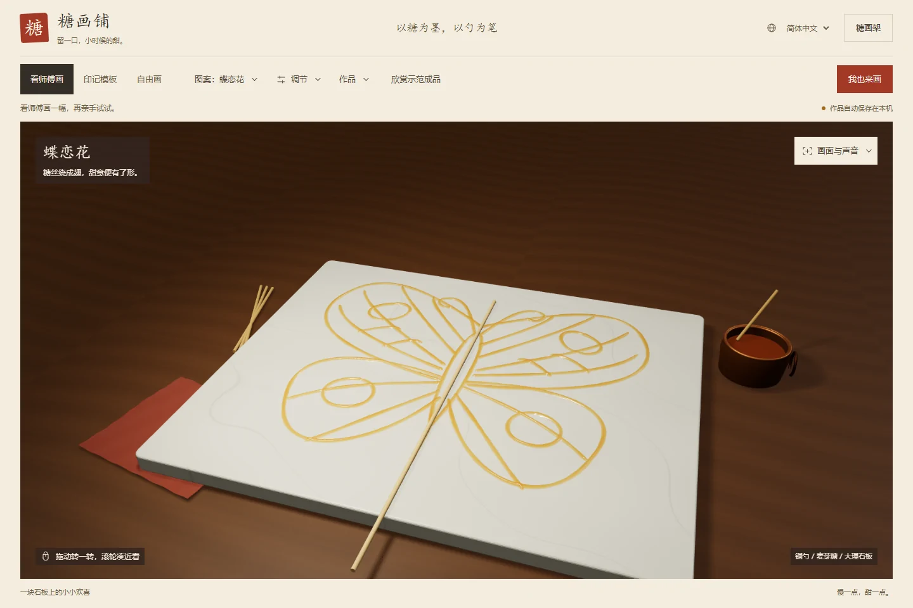
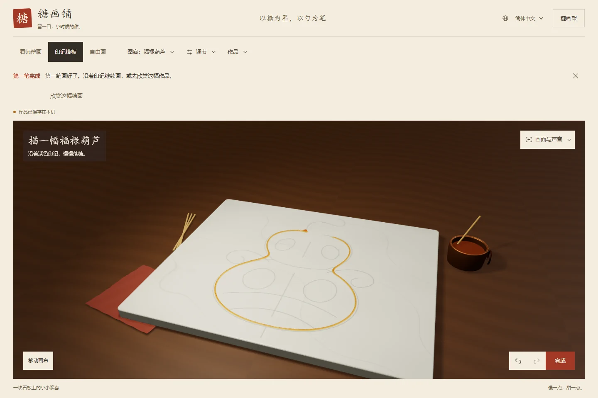
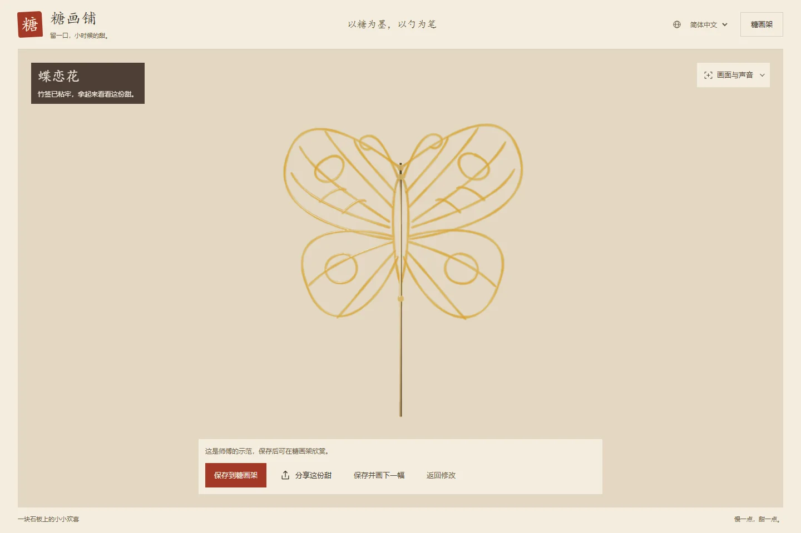
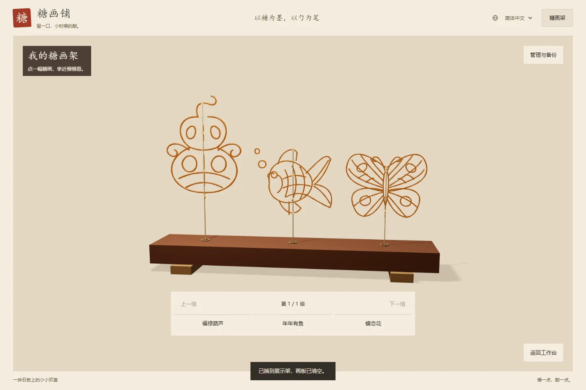
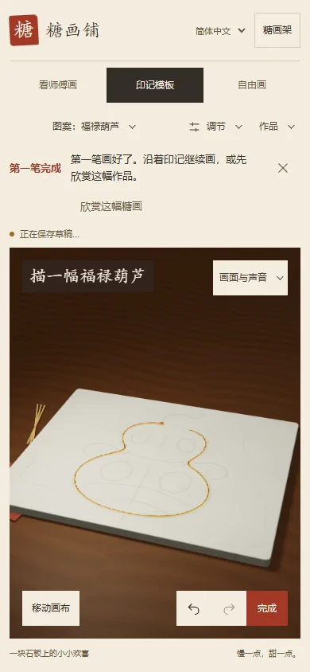

<div align="center">

[简体中文](README.md) · [繁體中文](README.zh-TW.md) · [**English**](README.en.md) · [日本語](README.ja.md)

# Sugar Studio · 糖画铺

**Sugar is the ink. A spoon is the brush.**

A sugar painting studio in your browser. Watch a copper ladle pour, trace a pattern, then place your creation on the display rack.


[Download offline edition](https://github.com/mephiroths/sugar-painting/raw/refs/heads/main/%E7%B3%96%E7%94%BB%E9%93%BA.html) · [Quick start](#quick-start) · [Make something sweet](#make-something-sweet) · [Development and verification](#development-and-verification)

</div>

<p align="center">
  
</p>

<p align="center"><sub>A copper ladle, sugar pot, wooden table, and marble slab generated in code, with sugar color and translucency that vary with thickness.</sub></p>

Screenshots show the Simplified Chinese interface. Use the language selector in the app header to switch to English, Traditional Chinese, or Japanese.

## One spoon, three ways to paint

| Watch | Trace a pattern | Draw freely |
| :--- | :--- | :--- |
| Watch the ladle pour butterflies, goldfish, and gourds stroke by stroke. Pause, change speed, or replay. | Start with a gourd and follow a faint guide. Seven patterns offer difficulty filters and guidance for each stroke. | Hold to pour, move to draw lines, and pause to build up sugar. Adjust flow and ladle height to shape your strokes. |

- **Pick up where you left off.** Freehand mode and each pattern keep separate drafts, with undo, redo, and artwork backups.
- **Lift it up and look closer.** Inspect the front, back, and details of your finished sugar painting, or place it on the 3D display rack.
- **Keep the process, too.** Replay how you made a painting, then export a PNG, share poster, or video in the current aspect ratio or 9:16 portrait format.
- **Paint on desktop or phone.** Mouse and touch input are supported. The interface offers Simplified Chinese, Traditional Chinese, English, and Japanese.

## Quick start

### Download and open

1. [Download the complete offline HTML](https://github.com/mephiroths/sugar-painting/raw/refs/heads/main/%E7%B3%96%E7%94%BB%E9%93%BA.html) and save it as `糖画铺.html`.
2. Open it in Chrome or Edge. No Node.js or dependency installation is required.
3. Select **English** in the app header, then click **Try painting** to start your first gourd.

> The offline file includes Three.js and background music. Artwork is stored in your current browser. Before moving to another device, export a JSON backup from **Display → Manage & back up**.

### Local development

Requires **Node.js 18 or later**.

```sh
git clone https://github.com/mephiroths/sugar-painting.git
cd sugar-painting
npm ci
npm start
```

Open [http://127.0.0.1:5177/?lang=en](http://127.0.0.1:5177/?lang=en) in your browser.

To try it on a phone, run `npm run preview:lan` after installing dependencies. Open the address printed in the terminal on a device connected to the same local network. See the [phone testing guide](PHONE-TESTING.md) for details.

## Make something sweet

<table>
  <tr>
    <td width="50%"></td>
    <td width="50%"></td>
  </tr>
  <tr>
    <td align="center"><b>Draw your first stroke</b><br><sub>Follow the guide and gradually connect the outline.</sub></td>
    <td align="center"><b>Lift up your creation</b><br><sub>Look at its thickness, translucency, and bamboo-stick attachments.</sub></td>
  </tr>
</table>

<p align="center">
  
  <br><sub>Save paintings to the display rack. Inspect them, replay their making, or reopen them to keep drawing.</sub>
</p>

<details>
<summary><b>See Sugar Studio on a phone</b></summary>

<p align="center">
  
</p>

Draw with touch. Enable **Move canvas** to pan with one finger or zoom with two, then switch back to drawing.

</details>

## Controls at a glance

| Action | Desktop control |
| :--- | :--- |
| Pour sugar | In drawing mode, hold the left mouse button and move |
| Rotate / zoom | In drawing mode, drag with the right button / use the scroll wheel |
| Adjust sugar flow | `Q` to decrease, `W` to increase |
| Adjust ladle height | `E` to lower, `R` to raise |
| Adjust replay speed | `A` to slow down, `S` to speed up |
| Pause / resume | Press `Space` while the work area has focus |
| Exit focus mode | `Esc` |

<details>
<summary><b>Saving, sharing, and moving artwork</b></summary>

- **Drafts** save automatically in the current browser. Freehand mode and individual patterns do not overwrite each other.
- **Display** stores named paintings and their making records, with editing and JSON import/export.
- **Images and posters** can be downloaded. On supported devices, send a poster through the system share sheet.
- **Experience links** are available only on public HTTP/HTTPS pages. They carry language and mode settings, without artwork stored on your device.
- **Video export** requires browser support for canvas recording. The music setting determines whether exported videos include audio. See [browser compatibility](COMPATIBILITY.md) for differences between engines.

Local files, different ports, and online addresses have separate artwork storage. Export a backup before clearing browser data.

</details>

## How the sugar works

A **768 × 632 height field** records the volume of deposited sugar. The falling stream has travel time, and movement speed affects line width. Height also drives surface shape, normals, refraction, and color absorption, giving thin lines, crossings, and thick deposits different appearances.

- **Scene:** Three.js rendering; the ladle, pot, bamboo sticks, wood grain, and marble texture are generated in code.
- **Making:** Strokes, deposited sugar, ladle movement, and parameter changes are recorded for replay and export.
- **Storage:** IndexedDB stores drafts and artwork; JSON backups support migration.
- **Delivery:** esbuild generates a complete offline HTML file and a web deployment package.

This is a surface and optical approximation for an interactive experience. See [feature and implementation details](docs/FEATURES.md) and [realism research](REALISM.md) for the limits of pouring, cooling, stick attachment, and replay.

## Development and verification

```sh
# Install Chromium before running browser checks for the first time
npx playwright install chromium

# Check source syntax
npm run check

# Build the offline HTML and web deployment package
npm run build

# Build and run the full verification suite
npm run verify
```

| Command | Purpose |
| :--- | :--- |
| `npm run preview` | Build and preview the offline edition at `127.0.0.1:5178` |
| `npm run verify:ux` | Verify workflows, four interface languages, and responsive layouts |
| `npm run verify:share` | Verify share posters, downloads, and failure recovery |
| `npm run verify:display` | Verify finished-work framing, stick attachment, and the display rack |
| `npm run verify:compat` | Run additional Chromium, Firefox, and WebKit checks; see [setup instructions](COMPATIBILITY.md) |

Build outputs are `糖画铺.html` in the project root and `artifacts/vercel-site/`. Test results go into the Git-ignored `artifacts/` directory. If you use a custom browser cache, keep `PLAYWRIGHT_BROWSERS_PATH` consistent during installation and verification.

<details>
<summary><b>Project structure</b></summary>

```text
sugar-painting/
├── src/                  # Interaction, sugar surfaces, guides, storage, sharing, and i18n
├── assets/               # Music and provenance
├── vendor/               # Three.js and third-party notices
├── docs/                 # Project docs, feature details, and showcase images
├── tools/compat/         # Cross-browser test driver
├── index.html            # Development page
├── build.mjs             # Offline HTML and web package build
├── verify-*.mjs          # Feature, compatibility, and visual checks
└── 糖画铺.html           # Offline edition, ready to open
```

</details>

## Documentation and credits

The supporting documents below are currently in Simplified Chinese.

| Topic | Start here |
| :--- | :--- |
| Full features and implementation limits | [Feature details](docs/FEATURES.md) |
| Project introduction | [Project guide](docs/糖画铺项目说明文档.md) · [Word edition](docs/糖画铺项目说明文档.docx) |
| Design and interaction | [Design notes](DESIGN.md) · [UX review](UX_REVIEW.md) |
| Browsers and phones | [Browser compatibility](COMPATIBILITY.md) · [Phone testing](PHONE-TESTING.md) |
| Finished artwork and display performance | [Realism research](REALISM.md) · [Display performance](RACK-PERFORMANCE.md) |
| Release status and future work | [Launch review](LAUNCH_REVIEW.md) |

3D rendering uses [Three.js](https://threejs.org/), under the MIT license recorded in the [third-party notice](vendor/THREE-LICENSE.txt). Music is *Asian Chinese Background Music* by Tunetank. Its source, Pixabay license, and Content ID record are listed in the [music notice](assets/MUSIC-LICENSE.txt). Keep the relevant license evidence when publishing exported videos with music.

Visual research referenced the AMIX PHENOMENA honey demo. The sugar surface and interactions were implemented independently, without copying its source code or media assets.

---

<p align="center"><b>One spoonful, one stroke at a time.</b><br><sub>A little sugar-painting stall, kept in your browser.</sub></p>
