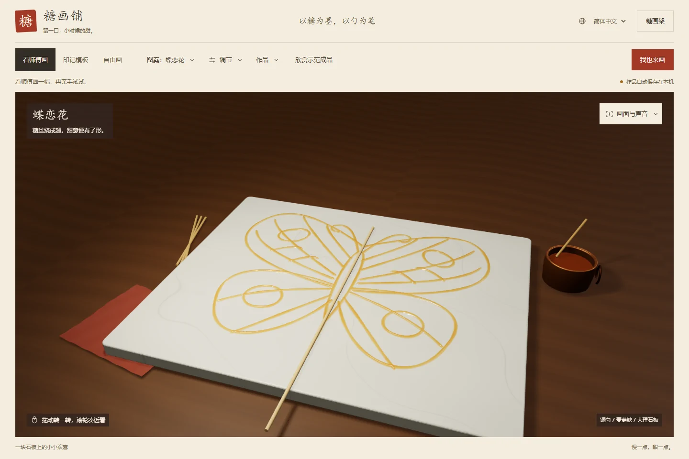
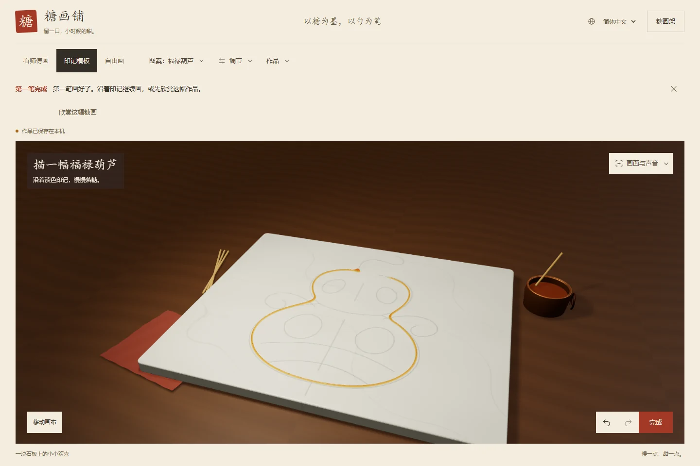
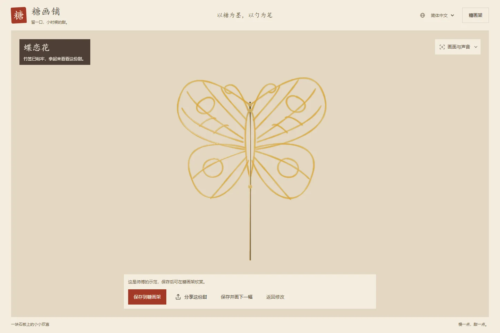
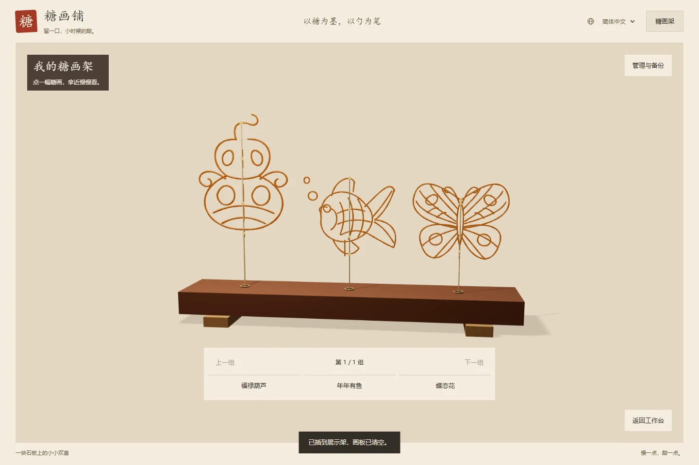
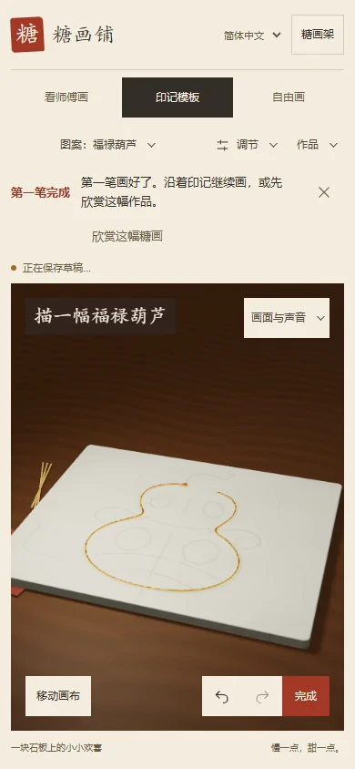

<div align="center">

[简体中文](README.md) · [繁體中文](README.zh-TW.md) · [English](README.en.md) · [**日本語**](README.ja.md)

# 糖画工房 · Sugar Studio

**飴を墨に、ひしゃくを筆に。**

街角の糖画屋台をブラウザーへ。銅のひしゃくから飴を流し、下絵をなぞり、できあがった一枚を飾り台に。


[オフライン版をダウンロード](https://github.com/mephiroths/sugar-painting/raw/refs/heads/main/%E7%B3%96%E7%94%BB%E9%93%BA.html) · [はじめる](#はじめる) · [甘い一枚を描く](#甘い一枚を描く) · [開発と検証](#開発と検証)

</div>

<p align="center">
  
</p>

<p align="center"><sub>銅のひしゃく、飴の鍋、木の机、石板をコードで生成。飴の厚みに応じて色と透け方が変わります。</sub></p>

スクリーンショットは簡体字中国語の画面です。アプリ上部の言語メニューから日本語、繁体字中国語、英語に切り替えられます。

## ひとさじで、三つの楽しみ方

| お手本を見る | 下絵をなぞる | 自由に描く |
| :--- | :--- | :--- |
| 蝶、金魚、ひょうたんを銅のひしゃくが一筆ずつ描きます。一時停止、速度変更、再生に対応。 | まずはひょうたんの練習から。薄い下絵をなぞって飴を落とします。7種類の図案を難易度で選び、一筆ずつ練習できます。 | 押し続けると飴が落ち、動かすと線に、止めると厚みに。飴の量とひしゃくの高さを調整して、自分の筆跡を作れます。 |

- **続きは、また今度。** 自由描画と各図案の下書きを別々に保存。元に戻す、やり直し、作品のバックアップにも対応します。
- **持ち上げて、じっくり見る。** 完成した立体の糖画を表、裏、細部から眺めたり、3Dの飾り台に並べたりできます。
- **制作過程も残せます。** 飴を流した過程を再生し、PNG、共有用ポスター、現在の画角または9:16の縦型動画を書き出せます。
- **パソコンでもスマートフォンでも。** マウスとタッチに対応。画面は簡体字中国語、繁体字中国語、英語、日本語から選べます。

## はじめる

### ダウンロードして開く

1. [オフラインHTMLをダウンロード](https://github.com/mephiroths/sugar-painting/raw/refs/heads/main/%E7%B3%96%E7%94%BB%E9%93%BA.html)し、`糖画铺.html` として保存します。
2. ChromeまたはEdgeで開きます。Node.jsや依存パッケージのインストールは不要です。
3. アプリ上部で **日本語** を選び、**自分で描く** を押して、最初のひょうたんを描きましょう。

> オフラインファイルにはThree.jsとBGMが含まれています。作品は使用中のブラウザーに保存されます。別の端末に移る前に、飾り台の「管理・バックアップ」からJSONバックアップを書き出してください。

### ローカル開発

**Node.js 18以降**が必要です。

```sh
git clone https://github.com/mephiroths/sugar-painting.git
cd sugar-painting
npm ci
npm start
```

ブラウザーで [http://127.0.0.1:5177/?lang=ja](http://127.0.0.1:5177/?lang=ja) を開きます。

スマートフォンで試すには、依存パッケージのインストール後に `npm run preview:lan` を実行します。同じローカルネットワークに接続した端末で、ターミナルに表示されたアドレスを開いてください。詳しくは[スマートフォンのテスト手順](PHONE-TESTING.md)を参照してください。

## 甘い一枚を描く

<table>
  <tr>
    <td width="50%"></td>
    <td width="50%"></td>
  </tr>
  <tr>
    <td align="center"><b>最初の一筆を描く</b><br><sub>下絵をなぞり、少しずつ輪郭をつなぎます。</sub></td>
    <td align="center"><b>できあがりを持ち上げる</b><br><sub>厚み、透け方、竹串との接合部を眺めます。</sub></td>
  </tr>
</table>

<p align="center">
  
  <br><sub>作品を飾り台に保存。近くで眺め、制作過程を再生し、もう一度開いて描き足せます。</sub>
</p>

<details>
<summary><b>スマートフォンの糖画工房を見る</b></summary>

<p align="center">
  
</p>

指で描けます。「キャンバスを移動」を有効にすると、1本指で平行移動、2本指で拡大縮小できます。描画に戻れば、そのまま続きを描けます。

</details>

## 操作一覧

| 操作 | パソコンでの操作方法 |
| :--- | :--- |
| 飴を落とす | 描画モードでマウスの左ボタンを押しながら移動 |
| 回転 / 拡大縮小 | 描画モードで右ボタンを押しながらドラッグ / ホイール |
| 飴の量を調整 | `Q` で減らす、`W` で増やす |
| ひしゃくの高さを調整 | `E` で低く、`R` で高く |
| 再生速度を調整 | `A` で遅く、`S` で速く |
| 一時停止 / 再開 | 作業エリアにフォーカスがある状態で `Space` |
| 集中モードを終了 | `Esc` |

<details>
<summary><b>保存、共有、端末間の移行</b></summary>

- **下書き**は使用中のブラウザーに自動保存されます。自由描画と各図案の内容は互いに上書きされません。
- **飾り台**には名前を付けた作品と制作記録を保存できます。再編集とJSONの読み込み・書き出しに対応します。
- **画像とポスター**はダウンロードできます。対応端末では、システムの共有画面からポスターを送れます。
- **体験リンク**は公開HTTP/HTTPSページでのみ利用できます。言語とモードを引き継ぎますが、端末内の作品は含みません。
- **動画の書き出し**には、ブラウザーのキャンバス録画機能が必要です。BGMの設定に応じて、音声付きまたは無音で書き出します。エンジンごとの差は[互換性の説明](COMPATIBILITY.md)を参照してください。

ローカルファイル、異なるポート、オンラインのURLでは作品の保存領域が分かれます。ブラウザーのデータを消去する前に、バックアップを書き出してください。

</details>

## 飴の表現のしくみ

**768 × 632の高さ場**で、落ちた飴の体積を記録します。飴の流れには落下時間があり、ひしゃくの移動速度によって線の太さが変わります。高さは表面の形状、法線、屈折、色の吸収にも反映され、細い線、交差部分、厚くたまった飴に異なる質感を与えます。

- **シーン**：Three.jsで描画。銅のひしゃく、鍋、竹串、木目、石目はコードで生成します。
- **制作記録**：筆跡、飴の量、ひしゃくの動き、設定の変化を記録し、再生と書き出しに使います。
- **保存**：下書きと作品をIndexedDBに保存。JSONバックアップで移行できます。
- **配布**：esbuildで単一のオフラインHTMLとWeb公開用パッケージを生成します。

対話的な体験のために、表面と光学特性を近似しています。制作、冷却、竹串の取り付け、再生に関する実装範囲は[機能と実装の詳細](docs/FEATURES.md)と[写実表現の調査](REALISM.md)を参照してください。

## 開発と検証

```sh
# 初めてブラウザー検証を実行する前にChromiumをインストール
npx playwright install chromium

# ソースコードの構文チェック
npm run check

# オフラインHTMLとWeb公開用パッケージをビルド
npm run build

# ビルドして全検証を実行
npm run verify
```

| コマンド | 用途 |
| :--- | :--- |
| `npm run preview` | ビルドし、`127.0.0.1:5178` でオフライン版をプレビュー |
| `npm run verify:ux` | 操作フロー、4言語、レスポンシブなレイアウトを検証 |
| `npm run verify:share` | 共有用ポスター、ダウンロード、失敗時の復帰を検証 |
| `npm run verify:display` | 完成作品の構図、竹串の接合、飾り台を検証 |
| `npm run verify:compat` | Chromium、Firefox、WebKitで追加検証。[準備方法](COMPATIBILITY.md)を参照 |

出力先はルートの `糖画铺.html` と `artifacts/vercel-site/` です。検証結果はGitの追跡対象外の `artifacts/` に保存されます。ブラウザーのキャッシュ先を変更する場合は、インストール時と検証時で同じ `PLAYWRIGHT_BROWSERS_PATH` を指定してください。

<details>
<summary><b>プロジェクト構成</b></summary>

```text
sugar-painting/
├── src/                  # 操作、飴の表面、下絵、保存、共有、多言語対応
├── assets/               # BGMと出典
├── vendor/               # Three.jsと第三者のライセンス表示
├── docs/                 # プロジェクト説明、機能詳細、紹介画像
├── tools/compat/         # ブラウザー間の互換性テスト用ドライバー
├── index.html            # 開発用ページ
├── build.mjs             # オフラインHTMLとWeb公開用パッケージのビルド
├── verify-*.mjs          # 機能、互換性、表示の検証
└── 糖画铺.html           # ダウンロードして使えるオフライン版
```

</details>

## ドキュメントとクレジット

以下の関連ドキュメントは、現在は簡体字中国語で提供しています。

| 知りたいこと | 関連ドキュメント |
| :--- | :--- |
| 全機能と実装範囲 | [機能と実装の詳細](docs/FEATURES.md) |
| プロジェクトの紹介 | [プロジェクト説明](docs/糖画铺项目说明文档.md) · [Word版](docs/糖画铺项目说明文档.docx) |
| デザインと操作 | [デザインの説明](DESIGN.md) · [UXレビュー](UX_REVIEW.md) |
| 互換性とスマートフォン | [ブラウザー互換性](COMPATIBILITY.md) · [スマートフォンのテスト](PHONE-TESTING.md) |
| 完成作品と表示性能 | [写実表現の調査](REALISM.md) · [飾り台の性能記録](RACK-PERFORMANCE.md) |
| 公開状況と今後の方向 | [公開前レビュー](LAUNCH_REVIEW.md) |

3D描画には [Three.js](https://threejs.org/) を使用しています。MITライセンスは[第三者のライセンス表示](vendor/THREE-LICENSE.txt)を参照してください。BGMはTunetankの「Asian Chinese Background Music」です。出典、Pixabayのライセンス、Content IDの記録は[音楽の説明](assets/MUSIC-LICENSE.txt)にあります。BGM付きの書き出し動画を公開する際は、該当する利用許諾の証明を保管してください。

視覚表現の調査ではAMIX PHENOMENAの蜂蜜デモを参考にしました。糖画の表面と操作は独自に実装し、デモのソースコードやメディア素材は複製していません。

---

<p align="center"><b>ひとさじの飴を、一筆ずつ。</b><br><sub>思い出の糖画屋台を、ブラウザーの中に。</sub></p>
