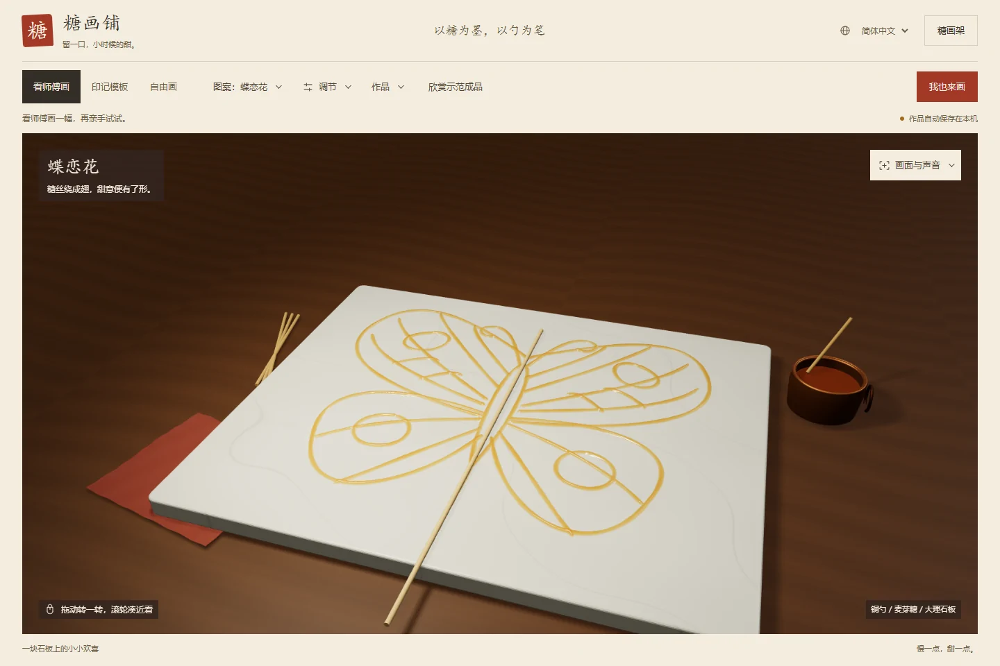
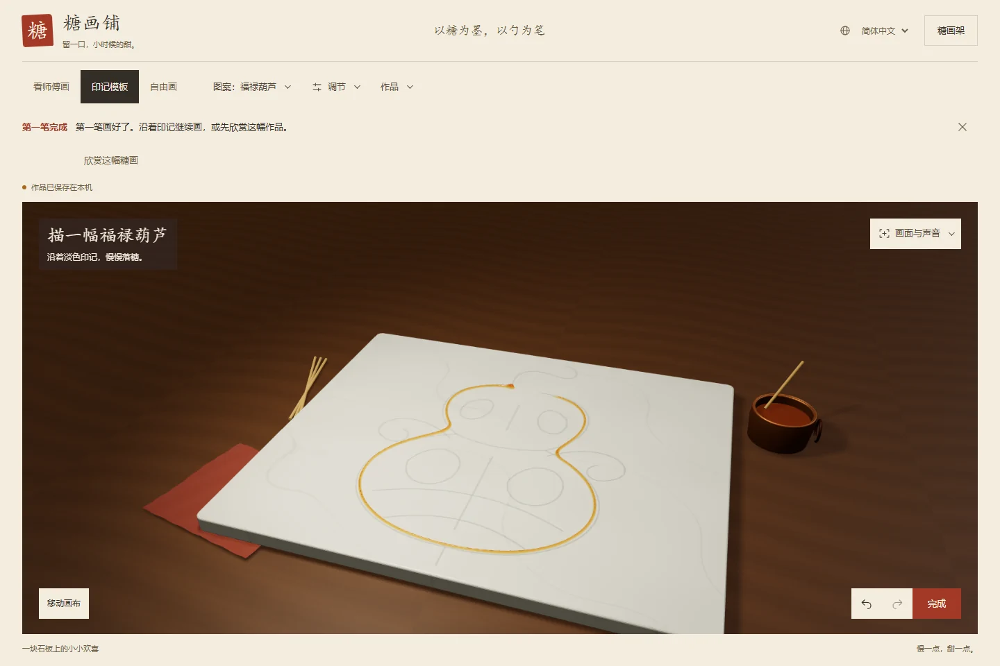
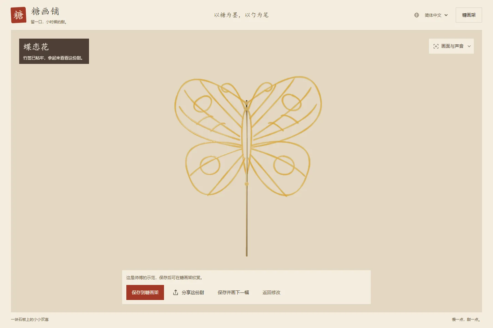
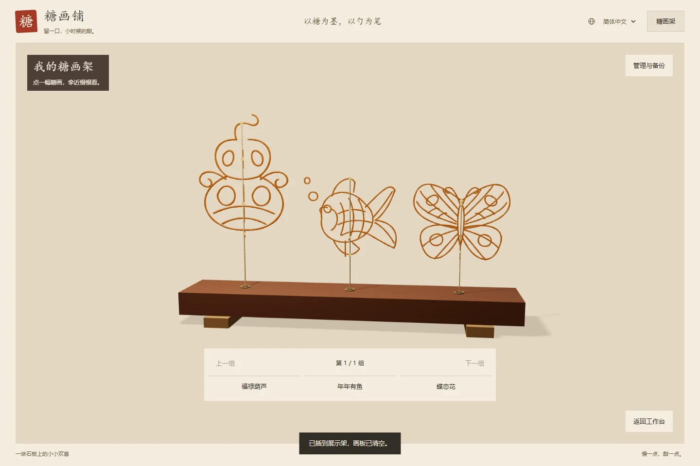
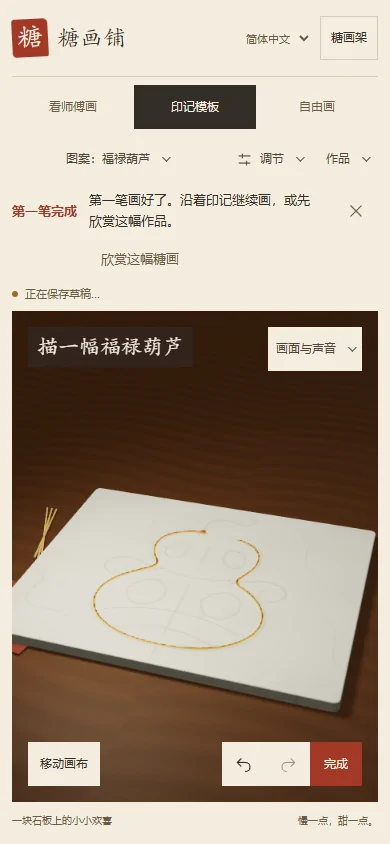

<div align="center">

[**简体中文**](README.md) · [繁體中文](README.zh-TW.md) · [English](README.en.md) · [日本語](README.ja.md)

# 糖画铺 · Sugar Studio

**以糖为墨，以勺为笔。**

把街边糖画摊搬进浏览器：看铜勺落糖，沿印记描画，再把一份甜插上展示架。

A sugar painting studio in your browser. Watch, trace, draw, and display your own sugar art.


[下载离线版](https://github.com/mephiroths/sugar-painting/raw/refs/heads/main/%E7%B3%96%E7%94%BB%E9%93%BA.html) · [快速开始](#快速开始) · [画一份甜](#画一份甜) · [开发与验证](#开发与验证)

</div>

<p align="center">
  
</p>

<p align="center"><sub>程序生成的铜勺、糖锅、木桌与石板，配上随厚度变化的糖色与透光。</sub></p>

## 一勺糖，三种玩法

| 看师傅画 | 沿着印记画 | 随心自由画 |
| :--- | :--- | :--- |
| 看铜勺逐笔浇出蝴蝶、金鱼与葫芦，可暂停、调速、重播。 | 从葫芦练习开始，沿淡色印记落糖；七种图案提供难度筛选与逐笔引导。 | 按住就能落糖，移动拉线、停留积糖；调整出糖量和提勺高度，画出自己的笔触。 |

- **画到一半，下次接着画。** 自由画和每张模板分别保存草稿，支持撤销、重做与作品备份。
- **拿起来，换个角度看。** 完成后欣赏立体糖画的正面、背面与细节，也能插入三维糖画架。
- **把制作过程一起留下。** 回看自己的浇糖过程，导出 PNG、分享海报或横屏与 9:16 竖屏视频。
- **桌面和手机都能画。** 支持鼠标与触摸，界面可切换简体中文、繁體中文、English 和日本語。

## 快速开始

### 下载即用

1. [下载完整离线 HTML](https://github.com/mephiroths/sugar-painting/raw/refs/heads/main/%E7%B3%96%E7%94%BB%E9%93%BA.html)，保存为 `糖画铺.html`。
2. 用 Chrome 或 Edge 打开，无需安装 Node.js 或依赖。
3. 点击 **我也来画**，从第一只葫芦开始。

> 离线文件已包含 Three.js 和配乐。作品保存在当前浏览器中；更换设备前，可在糖画架的“管理与备份”里导出 JSON 备份。

### 本地开发

需要 **Node.js 18 或更新版本**。

```sh
git clone https://github.com/mephiroths/sugar-painting.git
cd sugar-painting
npm ci
npm start
```

浏览器访问 [http://127.0.0.1:5177](http://127.0.0.1:5177)。

手机体验可在安装依赖后执行 `npm run preview:lan`，按终端提示打开同一局域网内的地址。完整步骤见 [手机测试指南](PHONE-TESTING.md)。

## 画一份甜

<table>
  <tr>
    <td width="50%"></td>
    <td width="50%"></td>
  </tr>
  <tr>
    <td align="center"><b>描出第一笔</b><br><sub>沿着印记，把轮廓慢慢连起来。</sub></td>
    <td align="center"><b>拿起这一份甜</b><br><sub>看厚薄、透光与竹签粘接的细节。</sub></td>
  </tr>
</table>

<p align="center">
  
  <br><sub>作品存进糖画架，随时拿近观察、回看制作，或重新打开继续修改。</sub>
</p>

<details>
<summary><b>看看手机上的糖画铺</b></summary>

<p align="center">
  
</p>

手机支持触摸绘画。开启“移动画布”后，可单指平移、双指缩放，再切回绘画继续描线。

</details>

## 操作速查

页面右上角的 **设置** 集中提供配乐、语言、绘画调节、画面与作品操作。绘画时底部仅保留撤销、重做和“拿起来看看”；观看自己的制作过程时，可用“返回绘画”回到原作。

### 导入自己的图案

打开左上的 **图案** 菜单，选择 **导入图案**，预览后选择玩法：

- **PNG、JPG、WebP 图片**：选择“照着画”，图片按比例居中铺在石板上作为底稿，可调节印记深浅或隐藏。清晰线稿的描画效果最好。
- **SVG 线稿**：既可“照着画”，也可“看师傅画”。示范按 SVG 文件中的线条轮廓和顺序浇画，支持常见路径、几何形状与分组变换；文字与嵌入图片需要先转为路径。

单个文件最大 8 MB，本机最多保存 32 张导入图案；不会上传图片。导入图案可在“我的图案”筛选中找到，各自保存独立草稿。保存到糖画架的作品备份包含对应底稿，可随作品迁移。普通体验链接不携带本机图案。

### 常用操作

| 操作 | 桌面方式 |
| :--- | :--- |
| 落糖 | 绘画模式下，按住鼠标左键并移动 |
| 旋转 / 缩放 | 绘画模式下右键拖动 / 滚轮 |
| 调整出糖量 | `Q` 减少，`W` 增加 |
| 调整提勺高度 | `E` 降低，`R` 提高 |
| 调整回放速度 | `A` 减慢，`S` 加快 |
| 暂停 / 继续 | 工作台获得焦点后按 `Space` |
| 退出专注模式 | `Esc` |

<details>
<summary><b>保存、分享与迁移</b></summary>

- **草稿**自动保存到当前浏览器，自由画与各模板互不覆盖。
- **糖画架**保存命名作品与制作记录，支持继续编辑和 JSON 导入、导出。
- **图片与海报**可下载；设备支持时，可通过系统分享面板发送海报。
- **体验链接**只在公开 HTTP/HTTPS 页面提供，携带语言和模式，不包含本机作品。
- **视频导出**需要浏览器支持画布录制；配乐开关决定导出有声或无声视频。各引擎差异见 [兼容性说明](COMPATIBILITY.md)。

本地文件、不同端口和线上网址的作品存储互相独立。清除浏览器数据前，请先导出备份。

</details>

## 如何做出这层糖

糖层采用 **768 × 632 高度场**记录落糖体积。下落细流具有飞行时间，移动速度影响局部线宽；高度同时驱动表面形状、法线、折射与颜色吸收，让薄线、交叉和积糖呈现不同质感。

- **场景**：Three.js 渲染，铜勺、糖锅、竹签、木纹与石纹由代码生成。
- **制作**：记录笔画、落糖量、铜勺运动及参数变化，用于过程回放与导出。
- **存储**：IndexedDB 保存草稿与作品，JSON 备份用于迁移。
- **交付**：esbuild 构建完整离线 HTML，同时生成网页发布包。

这是面向互动体验的表面与光学近似。制作、冷却、成品粘签与回放的实现边界见 [功能与实现细节](docs/FEATURES.md) 和 [糖画写实研究](REALISM.md)。

## 开发与验证

发布前 UI / UX 已做一轮修正：小屏工具保持可达、描画默认斜视并显示起笔引导、保存前命名并说明去向、详情收起次要操作、分享海报独立取景。修改及实测范围见 [本轮修改记录](docs/UI-UX-FIXES-2026-11-06.md)。可用 `npm run verify:publication` 运行对应专项检查。

```sh
# 首次运行浏览器验证前，安装 Chromium
npx playwright install chromium

# 源码语法检查
npm run check

# 构建离线 HTML 和网页发布包
npm run build

# 构建并运行完整验证
npm run verify
```

| 命令 | 用途 |
| :--- | :--- |
| `npm run preview` | 构建并在 `127.0.0.1:5178` 预览离线版 |
| `npm run verify:publication` | 验证发布前布局、斜视角、保存与分享流程 |
| `npm run verify:ux` | 验证操作流程、四语与响应式布局 |
| `npm run verify:share` | 验证分享海报、下载与失败恢复 |
| `npm run verify:display` | 验证成品取景、粘签与糖画架 |
| `npm run verify:compat` | 补充 Chromium、Firefox、WebKit 验证；准备方式见 [兼容性说明](COMPATIBILITY.md) |
| `npm run verify:import` | 验证图片与 SVG 导入、独立草稿、保存失败重试及底稿随作品备份迁移 |
| `npm run verify:settings` | 验证统一设置、四语布局、矮窗口及绘画和回放工具栏切换 |

构建输出为根目录的 `糖画铺.html` 和 `artifacts/vercel-site/`。测试结果写入 Git 忽略的 `artifacts/`；自定义浏览器缓存目录时，在安装与验证中保持 `PLAYWRIGHT_BROWSERS_PATH` 一致。

<details>
<summary><b>项目结构</b></summary>

```text
sugar-painting/
├── src/                  # 交互、糖层、模板、存储、分享与国际化
├── assets/               # 配乐与来源声明
├── vendor/               # Three.js 与第三方声明
├── docs/                 # 项目说明、详细功能与展示图片
├── tools/compat/         # 跨浏览器测试驱动
├── index.html            # 开发页面
├── build.mjs             # 离线文件与网页发布包构建
├── verify-*.mjs          # 功能、兼容性与视觉验证
└── 糖画铺.html           # 下载即用的离线版
```

</details>

## 文档与致谢

| 想了解什么 | 从这里开始 |
| :--- | :--- |
| 完整功能与实现边界 | [功能与实现细节](docs/FEATURES.md) |
| 项目介绍 | [项目说明文档](docs/糖画铺项目说明文档.md) · [Word 版](docs/糖画铺项目说明文档.docx) |
| 设计与交互 | [设计说明](DESIGN.md) · [体验审查](UX_REVIEW.md) |
| 兼容性与手机体验 | [浏览器兼容性](COMPATIBILITY.md) · [手机测试指南](PHONE-TESTING.md) |
| 成品效果与展示性能 | [写实研究](REALISM.md) · [糖画架性能记录](RACK-PERFORMANCE.md) |
| 上线状态与后续方向 | [上线审查](LAUNCH_REVIEW.md) |

三维渲染使用 [Three.js](https://threejs.org/)，其 MIT 许可见 [第三方声明](vendor/THREE-LICENSE.txt)。配乐为 Tunetank 的《Asian Chinese Background Music》，来源、Pixabay 许可及 Content ID 记录见 [配乐声明](assets/MUSIC-LICENSE.txt)。发布带配乐的导出视频时，请保留相应授权证明。

视觉研究参考 AMIX PHENOMENA 的蜂蜜演示；糖画层与交互独立实现，未复制其源码或媒体资产。

---

<p align="center"><b>一勺糖，慢慢浇成。</b><br><sub>把记忆里的糖画摊，留在浏览器里。</sub></p>
