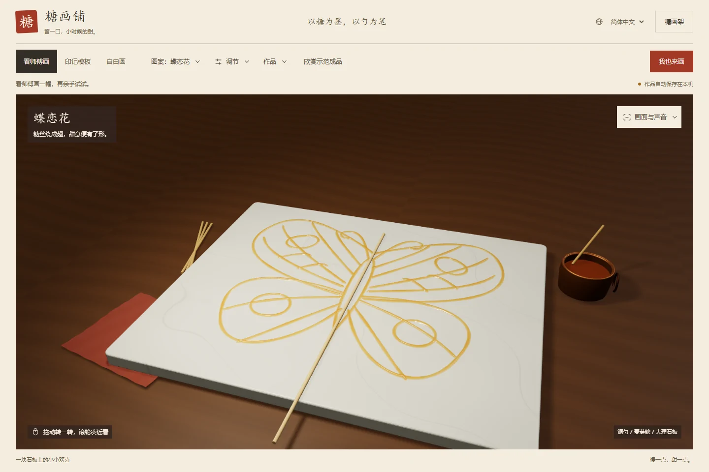
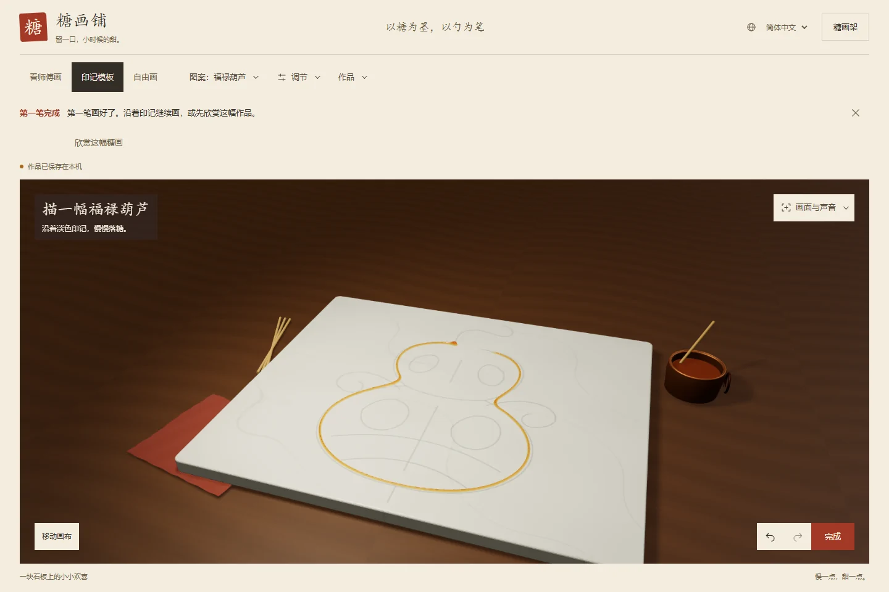
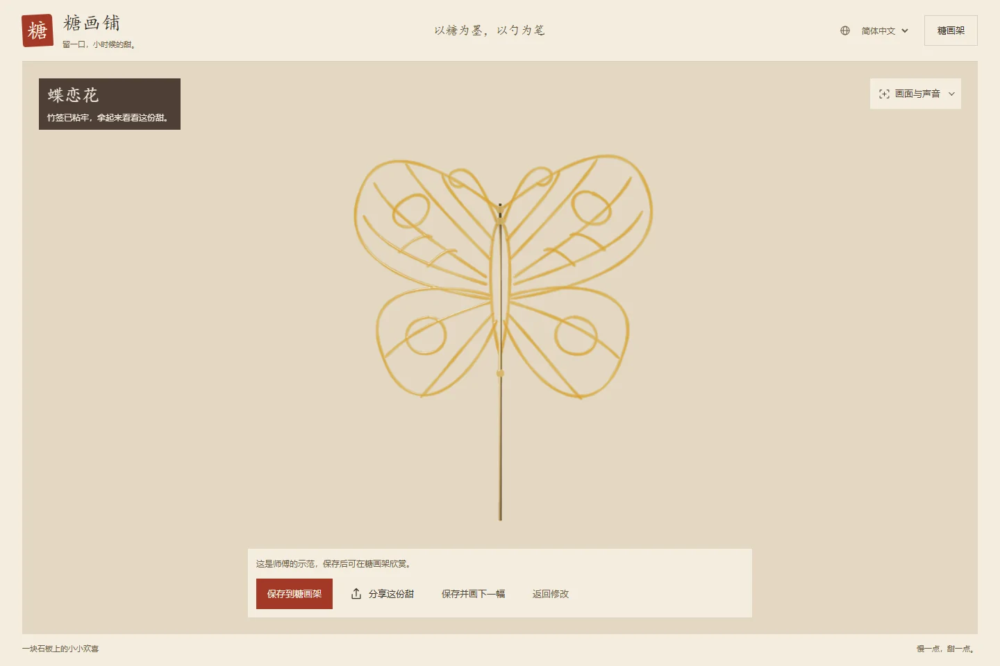
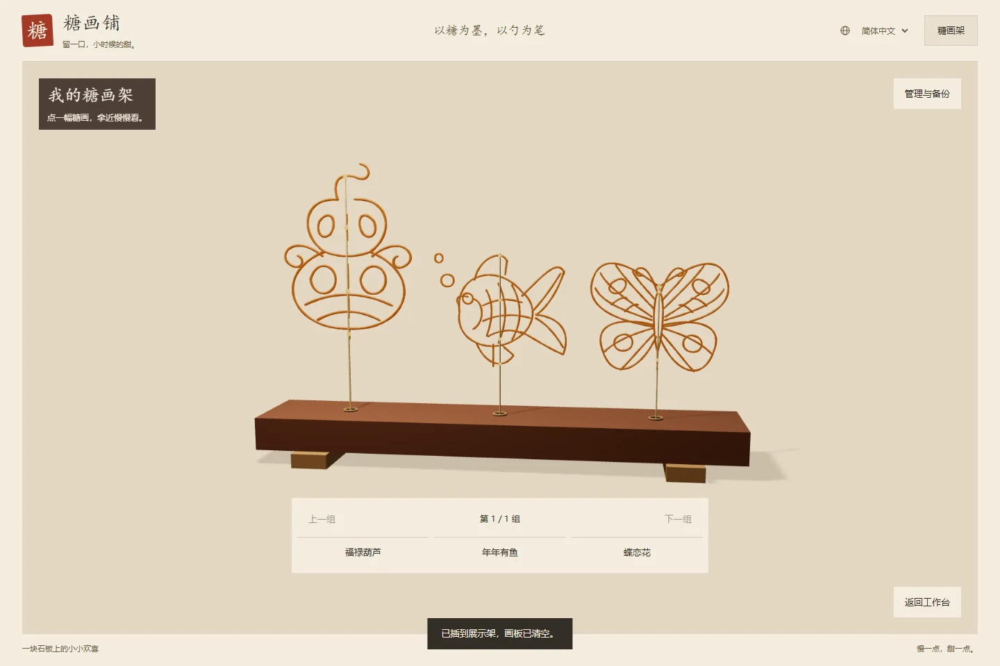
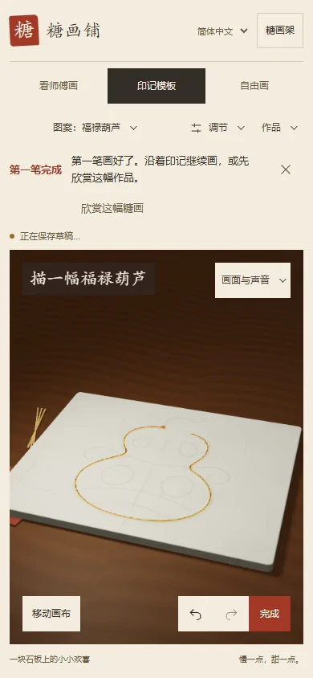

<div align="center">

[简体中文](README.md) · [**繁體中文**](README.zh-TW.md) · [English](README.en.md) · [日本語](README.ja.md)

# 糖畫鋪 · Sugar Studio

**以糖為墨，以勺為筆。**

把街邊糖畫攤搬進瀏覽器：看銅勺落糖，沿印記描畫，再把一份甜插上展示架。

A sugar painting studio in your browser. Watch, trace, draw, and display your own sugar art.


[下載離線版](https://github.com/mephiroths/sugar-painting/raw/refs/heads/main/%E7%B3%96%E7%94%BB%E9%93%BA.html) · [快速開始](#快速開始) · [畫一份甜](#畫一份甜) · [開發與驗證](#開發與驗證)

</div>

<p align="center">
  
</p>

<p align="center"><sub>程式生成的銅勺、糖鍋、木桌與石板，配上隨厚度變化的糖色與透光。</sub></p>

截圖使用簡體中文介面。可在應用程式頁首切換為繁體中文、English 或日本語。

## 一勺糖，三種玩法

| 看師傅畫 | 沿著印記畫 | 隨心自由畫 |
| :--- | :--- | :--- |
| 看銅勺逐筆澆出蝴蝶、金魚與葫蘆，可暫停、調速、重播。 | 從葫蘆練習開始，沿淡色印記落糖；七種圖案提供難度篩選與逐筆引導。 | 按住就能落糖，移動拉線、停留積糖；調整出糖量和提勺高度，畫出自己的筆觸。 |

- **畫到一半，下次接著畫。** 自由畫和每張模板分別儲存草稿，支援復原、重做與作品備份。
- **拿起來，換個角度看。** 完成後欣賞立體糖畫的正面、背面與細節，也能插入三維糖畫架。
- **把製作過程一起留下。** 回看自己的澆糖過程，匯出 PNG、分享海報，或目前畫幅與 9:16 直式影片。
- **桌面和手機都能畫。** 支援滑鼠與觸控，介面可切換簡體中文、繁體中文、English 和日本語。

## 快速開始

### 下載即用

1. [下載完整離線 HTML](https://github.com/mephiroths/sugar-painting/raw/refs/heads/main/%E7%B3%96%E7%94%BB%E9%93%BA.html)，儲存為 `糖画铺.html`。
2. 用 Chrome 或 Edge 開啟，無需安裝 Node.js 或相依套件。
3. 在頁首選擇 **繁體中文**，點擊 **我也來畫**，從第一隻葫蘆開始。

> 離線檔案已包含 Three.js 和配樂。作品儲存在目前的瀏覽器中；更換裝置前，可在糖畫架的「管理與備份」中匯出 JSON 備份。

### 本機開發

需要 **Node.js 18 或更新版本**。

```sh
git clone https://github.com/mephiroths/sugar-painting.git
cd sugar-painting
npm ci
npm start
```

瀏覽器開啟 [http://127.0.0.1:5177/?lang=zh-TW](http://127.0.0.1:5177/?lang=zh-TW)。

手機體驗可在安裝相依套件後執行 `npm run preview:lan`，依終端機提示開啟同一區域網路內的位址。完整步驟見 [手機測試指南](PHONE-TESTING.md)。

## 畫一份甜

<table>
  <tr>
    <td width="50%"></td>
    <td width="50%"></td>
  </tr>
  <tr>
    <td align="center"><b>描出第一筆</b><br><sub>沿著印記，把輪廓慢慢連起來。</sub></td>
    <td align="center"><b>拿起這一份甜</b><br><sub>看厚薄、透光與竹籤黏接的細節。</sub></td>
  </tr>
</table>

<p align="center">
  
  <br><sub>作品存進糖畫架，隨時拿近觀察、回看製作，或重新開啟繼續修改。</sub>
</p>

<details>
<summary><b>看看手機上的糖畫鋪</b></summary>

<p align="center">
  
</p>

手機支援觸控繪畫。開啟「移動畫布」後，可單指平移、雙指縮放，再切回繪畫繼續描線。

</details>

## 操作速查

| 操作 | 桌面方式 |
| :--- | :--- |
| 落糖 | 繪畫模式下，按住滑鼠左鍵並移動 |
| 旋轉 / 縮放 | 繪畫模式下右鍵拖曳 / 滾輪 |
| 調整出糖量 | `Q` 減少，`W` 增加 |
| 調整提勺高度 | `E` 降低，`R` 提高 |
| 調整回放速度 | `A` 減慢，`S` 加快 |
| 暫停 / 繼續 | 工作臺取得焦點後按 `Space` |
| 退出專注模式 | `Esc` |

<details>
<summary><b>儲存、分享與搬移</b></summary>

- **草稿**自動儲存到目前的瀏覽器，自由畫與各模板互不覆蓋。
- **糖畫架**儲存命名作品與製作紀錄，支援繼續編輯和 JSON 匯入、匯出。
- **圖片與海報**可下載；裝置支援時，可透過系統分享面板傳送海報。
- **體驗連結**只在公開 HTTP/HTTPS 頁面提供，攜帶語言和模式，不包含本機作品。
- **影片匯出**需要瀏覽器支援畫布錄製；配樂開關決定匯出的影片是否有聲。各引擎差異見 [相容性說明](COMPATIBILITY.md)。

本機檔案、不同連接埠和線上網址的作品儲存互相獨立。清除瀏覽器資料前，請先匯出備份。

</details>

## 如何做出這層糖

糖層採用 **768 × 632 高度場**記錄落糖體積。下落細流具有飛行時間，移動速度影響局部線寬；高度同時驅動表面形狀、法線、折射與顏色吸收，讓薄線、交叉和積糖呈現不同質感。

- **場景**：Three.js 算繪，銅勺、糖鍋、竹籤、木紋與石紋由程式生成。
- **製作**：記錄筆畫、落糖量、銅勺運動及參數變化，用於過程回放與匯出。
- **儲存**：IndexedDB 儲存草稿與作品，JSON 備份用於搬移。
- **交付**：esbuild 建置完整離線 HTML，同時生成網頁發布套件。

這是面向互動體驗的表面與光學近似。製作、冷卻、成品黏籤與回放的實作範圍見 [功能與實作細節](docs/FEATURES.md) 和 [糖畫寫實研究](REALISM.md)。

## 開發與驗證

```sh
# 首次執行瀏覽器驗證前，安裝 Chromium
npx playwright install chromium

# 原始碼語法檢查
npm run check

# 建置離線 HTML 和網頁發布套件
npm run build

# 建置並執行完整驗證
npm run verify
```

| 指令 | 用途 |
| :--- | :--- |
| `npm run preview` | 建置並在 `127.0.0.1:5178` 預覽離線版 |
| `npm run verify:ux` | 驗證操作流程、四語與響應式版面 |
| `npm run verify:share` | 驗證分享海報、下載與失敗恢復 |
| `npm run verify:display` | 驗證成品取景、黏籤與糖畫架 |
| `npm run verify:compat` | 補充 Chromium、Firefox、WebKit 驗證；準備方式見 [相容性說明](COMPATIBILITY.md) |

建置輸出為根目錄的 `糖画铺.html` 和 `artifacts/vercel-site/`。測試結果寫入 Git 忽略的 `artifacts/`；自訂瀏覽器快取目錄時，安裝與驗證須使用相同的 `PLAYWRIGHT_BROWSERS_PATH`。

<details>
<summary><b>專案結構</b></summary>

```text
sugar-painting/
├── src/                  # 互動、糖層、模板、儲存、分享與國際化
├── assets/               # 配樂與來源聲明
├── vendor/               # Three.js 與第三方聲明
├── docs/                 # 專案說明、詳細功能與展示圖片
├── tools/compat/         # 跨瀏覽器測試驅動
├── index.html            # 開發頁面
├── build.mjs             # 離線檔案與網頁發布套件建置
├── verify-*.mjs          # 功能、相容性與視覺驗證
└── 糖画铺.html           # 下載即用的離線版
```

</details>

## 文件與致謝

以下延伸文件目前以簡體中文撰寫。

| 想了解什麼 | 從這裡開始 |
| :--- | :--- |
| 完整功能與實作範圍 | [功能與實作細節](docs/FEATURES.md) |
| 專案介紹 | [專案說明文件](docs/糖画铺项目说明文档.md) · [Word 版](docs/糖画铺项目说明文档.docx) |
| 設計與互動 | [設計說明](DESIGN.md) · [體驗審查](UX_REVIEW.md) |
| 相容性與手機體驗 | [瀏覽器相容性](COMPATIBILITY.md) · [手機測試指南](PHONE-TESTING.md) |
| 成品效果與展示效能 | [寫實研究](REALISM.md) · [糖畫架效能紀錄](RACK-PERFORMANCE.md) |
| 上線狀態與後續方向 | [上線審查](LAUNCH_REVIEW.md) |

三維算繪使用 [Three.js](https://threejs.org/)，其 MIT 授權見 [第三方聲明](vendor/THREE-LICENSE.txt)。配樂為 Tunetank 的《Asian Chinese Background Music》，來源、Pixabay 授權及 Content ID 紀錄見 [配樂聲明](assets/MUSIC-LICENSE.txt)。發布帶配樂的匯出影片時，請保留相應授權證明。

視覺研究參考 AMIX PHENOMENA 的蜂蜜示範；糖畫層與互動獨立實作，未複製其原始碼或媒體素材。

---

<p align="center"><b>一勺糖，慢慢澆成。</b><br><sub>把記憶裡的糖畫攤，留在瀏覽器裡。</sub></p>
